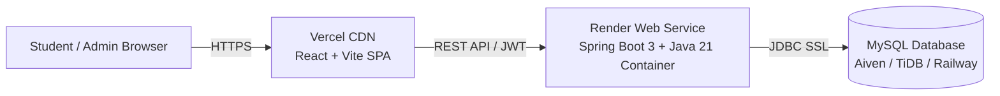

# Smart Campus Super App — Vercel & Render Deployment Guide

This guide walks you through deploying the **Frontend to Vercel** and the **Backend to Render** from your GitHub repository:
👉 [https://github.com/koushikneela25-web/smart-campus-super-app](https://github.com/koushikneela25-web/smart-campus-super-app)

---

## Architecture Overview

---

## Part 1: Deploy Backend to Render

Render hosts Docker containers with free HTTPS and automatic zero-downtime redeployments on git push.

### Option A: 1-Click Render Blueprint (Recommended)
1. Go to **[Render Blueprints](https://dashboard.render.com/blueprints)** and click **New Blueprint Instance**.
2. Connect your GitHub repository: `koushikneela25-web/smart-campus-super-app`.
3. Render will automatically detect the root `render.yaml` specification.
4. Provide your cloud MySQL database credentials:
   - `DB_HOST`: Hostname of your cloud MySQL instance (e.g., from TiDB Serverless, Aiven, or Railway)
   - `DB_PORT`: `3306`
   - `DB_NAME`: `smart_campus_db`
   - `DB_USERNAME`: Database user
   - `DB_PASSWORD`: Database password
5. Click **Apply**. Render will build the multi-stage Docker image and launch the service!

### Option B: Manual Web Service Setup
1. In [Render Dashboard](https://dashboard.render.com), click **New +** > **Web Service**.
2. Select your repository `smart-campus-super-app`.
3. Configure settings:
   - **Name**: `smart-campus-backend`
   - **Region**: Choose closest to you (e.g., Singapore or Oregon)
   - **Branch**: `main`
   - **Root Directory**: `backend`
   - **Runtime**: **Docker**
   - **Dockerfile Path**: `Dockerfile`
   - **Instance Type**: **Free**
4. Under **Advanced** > **Health Check Path**: `/actuator/health`
5. Under **Environment Variables**, add:
   | Key | Value | Description |
   | --- | --- | --- |
   | `PORT` | `10000` | Render standard port |
   | `SPRING_PROFILES_ACTIVE` | `prod` | Production Spring profile |
   | `APP_CORS_ALLOWED_ORIGINS` | `*` or `https://*.vercel.app` | Allows requests from your Vercel frontend |
   | `SPRING_DATASOURCE_URL` | `jdbc:mysql://<host>:<port>/<dbname>?useSSL=true` | Full JDBC MySQL URL (or use separate `DB_HOST` variables) |
   | `DB_USERNAME` | `<your-db-user>` | MySQL Username |
   | `DB_PASSWORD` | `<your-db-password>` | MySQL Password |
   | `JWT_SECRET` | `404E635266556A586E3272357538782F413F4428472B4B6250645367566B5970` | 256-bit secret key |
6. Click **Deploy Web Service**.
7. Once deployed, copy your backend URL: `https://smart-campus-backend.onrender.com`.

---

## Part 2: Deploy Frontend to Vercel

Vercel provides instant global edge CDN hosting for the React 18 + Vite frontend.

### Step-by-Step Vercel Deployment:
1. Go to **[Vercel Dashboard](https://vercel.com/new)**.
2. Under "Import Git Repository", choose **`koushikneela25-web/smart-campus-super-app`**.
3. In the project configuration:
   - **Project Name**: `smart-campus-super-app`
   - **Framework Preset**: `Vite`
   - **Root Directory**: Click edit and select `frontend` (or leave as root; both are supported via `vercel.json`).
   - **Build Command**: `npm run build`
   - **Output Directory**: `dist`
4. Expand **Environment Variables**:
   | Key | Value |
   | --- | --- |
   | `VITE_API_BASE_URL` | `https://smart-campus-backend.onrender.com/api/v1` *(replace with your actual Render backend URL)* |
5. Click **Deploy**.
6. Within ~30 seconds, Vercel will assign a production domain (e.g. `https://smart-campus-super-app.vercel.app`).

---

## Part 3: Cloud MySQL Database Setup

If you don't already have an external cloud MySQL instance for Render:

### Free Cloud MySQL Providers:
1. **[TiDB Cloud (Serverless)](https://tidbcloud.com/)** — Free 5GB MySQL-compatible database, instant provisioning.
2. **[Aiven for MySQL](https://aiven.io/mysql)** — Free tier with managed backups and SSL.
3. **[Railway](https://railway.app/)** — 1-click MySQL database plugin.

### Flyway Database Initializer:
Once connected, the Spring Boot backend automatically runs Flyway migrations on startup:
- `V1__init_schema.sql` (Creates all 21 tables, indexes, and constraints)
- `V2__seed_demo_data.sql` (Seeds demo faculty, students, courses, events, cafeterias, and admin accounts)

---

## Verification Checklist

- [ ] Backend Health Check: `https://<YOUR_RENDER_URL>/actuator/health` returns `{"status":"UP"}`.
- [ ] Backend API Docs: `https://<YOUR_RENDER_URL>/swagger-ui.html` opens OpenAPI UI.
- [ ] Frontend Live: `https://<YOUR_VERCEL_URL>` loads the Landing Page.
- [ ] 1-Click Demo Login: Logs in as Student / Admin and fetches data from the Render backend.
