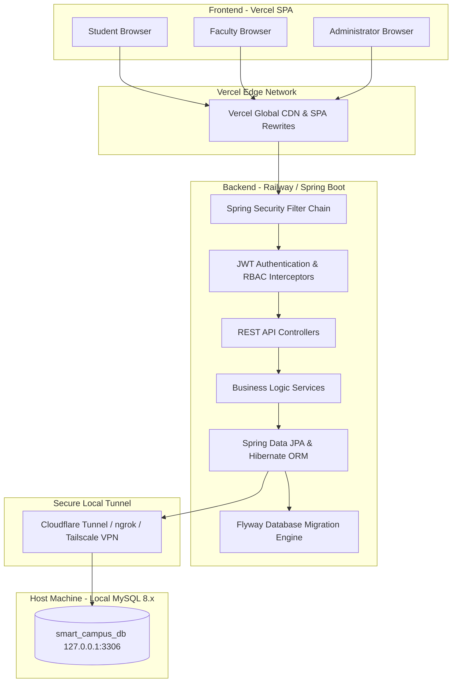
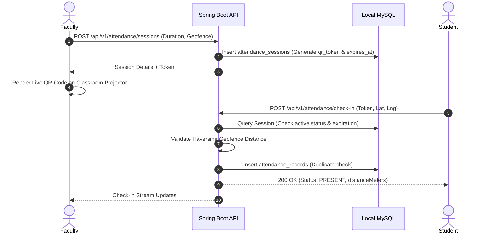

# Smart Campus Super App — Software Architecture Document

## 1. Executive Architecture Summary
The **Smart Campus Super App** is an enterprise-grade full-stack collegiate management system developed for modern higher education institutions. The platform is architected with a strict separation of concerns, decoupling a **React 18 + TypeScript SPA** deployed on **Vercel** from a high-performance **Java 21 + Spring Boot 3.3.4 REST API** running in containerized environments (e.g., **Railway**), backed exclusively by a locally hosted **MySQL 8.x** relational database via an encrypted tunneling layer.

---

## 2. System Architecture Overview



---

## 3. Core Architectural Modules

### 3.1 Authentication & Role-Based Access Control (RBAC)
- **Stateless Bearer Tokens**: Stateless JWT tokens generated with HMAC-SHA256 signatures (`HS256`). Access tokens carry 24-hour validity, while refresh tokens carry 7-day validity.
- **Roles & Hierarchies**:
  - `ROLE_STUDENT`: Personal attendance verification, timetable visualization, event RSVP, lost/found reporting.
  - `ROLE_FACULTY`: Live dynamic QR session initiation, classroom timetable consultation, event organization, CSV attendance reporting.
  - `ROLE_ADMIN`: User provisioning, academic department cataloging, conflict-checked timetable management, security audit logging, lost/found claim review.
- **Security Pipeline**:
  ```
  Incoming Request -> JwtAuthenticationFilter -> SecurityContextHolder -> Method Security (@PreAuthorize) -> Service Logic
  ```

### 3.2 Dynamic QR Code & Geofenced Attendance Engine
The attendance mechanism prevents proxy check-ins through two distinct cryptographic and geospatial layers:
1. **Dynamic Cryptographic Session Tokens**:
   - Generated using cryptographically strong `UUID.randomUUID()` strings.
   - Bounded by strict expiration timestamps (`qr_expires_at`), typically lasting 5 to 15 minutes.
   - Enforces database-level duplicate prevention: each `(session_id, student_id)` pair has a unique database index.
2. **Haversine Geofencing Algorithm**:
   - Optional geo-validation enforces that the student's physical location is within a configured radius (e.g., 100 meters) of the lecture hall.
   - Mathematical formula applied in [AttendanceService.java](file:///C:/Users/koush/.gemini/antigravity-ide/scratch/smart-campus-super-app/backend/src/main/java/com/smartcampus/attendance/AttendanceService.java):
     $$d = 2r \arcsin\left(\sqrt{\sin^2\left(\frac{\Delta \phi}{2}\right) + \cos(\phi_1)\cos(\phi_2)\sin^2\left(\frac{\Delta \lambda}{2}\right)}\right)$$
     Where $\phi$ represents latitude in radians, $\lambda$ represents longitude in radians, and $r = 6,371,000\text{ meters}$.



---

### 3.3 Conflict-Aware Academic Timetable Scheduling
To prevent institutional double-booking, the timetable engine evaluates three overlapping dimensions prior to record persistence:
1. **Faculty Conflict**: Ensures the assigned instructor is not teaching another section simultaneously on that weekday:
   $$\text{Start}_A < \text{End}_B \land \text{End}_A > \text{Start}_B$$
2. **Classroom Conflict**: Verifies that the physical lecture hall or laboratory is vacant during the specified slot.
3. **Section Cohort Conflict**: Ensures student cohorts do not have overlapping classes scheduled.

---

### 3.4 Campus Event Reservation Engine
- **Capacity Management**: Real-time optimistic seat locking prevents over-subscription.
- **Transactional Consistency**: Each registration query evaluates `registered_count < max_capacity` within a transactional boundary (`@Transactional`).
- **Duplicate Prevention**: The `event_registrations` table maintains a composite unique constraint `UNIQUE KEY (event_id, student_id)`.

---

### 3.5 Moderated Lost & Found Workflow
- **Item Categorization**: Electronic devices, student identity cards, textbooks, clothing, and keys.
- **Claims Proof Desk**: Claimants provide distinct ownership identifiers (e.g., serial numbers, device lock wallpapers, identifying stickers) reviewed by administrators before items are marked `RESOLVED`.

---

## 4. Technology Stack Specification

| Component | Technology | Rationale |
|---|---|---|
| **Frontend Framework** | React 18 + TypeScript | Type safety, declarative UI rendering |
| **Styling & Design** | Tailwind CSS + Lucide Icons | Responsive modern dark theme with HSL palettes |
| **Routing & Navigation** | React Router DOM v6 | Role-based layout nesting and client-side protection |
| **API Client** | Axios + TanStack Query | JWT interceptors, automatic bearer injection, caching |
| **Data Visualizations** | Recharts | Interactive SVG chart components for KPI metrics |
| **Backend Framework** | Spring Boot 3.3.4 (Java 21) | Production-ready Spring ecosystem and robust DI |
| **Security Layer** | Spring Security 6 + jjwt 0.12.6 | Stateless JWT authentication, BCrypt password hashing |
| **Persistence** | Spring Data JPA / Hibernate 6 | ORM with HikariCP connection pooling |
| **Database Migrations** | Flyway 10.x | Version-controlled, idempotent schema initialization |
| **Relational Database** | MySQL 8.x (Local Engine) | High-performance ACID storage with spatial indexing |
| **Documentation & API** | Springdoc OpenAPI 2.6 (Swagger UI) | Automated REST documentation and API sandbox |

---

## 5. Security & Threat Mitigation Model

1. **Password Storage**: All passwords hashed using `BCryptPasswordEncoder` with strength factor 10.
2. **Audit Logging**: Sensitive operations (logins, timetable mutations, claim approvals, status transitions) are persisted to the `audit_logs` table with client IP addresses.
3. **CORS Governance**: Whitelisted origin headers configurable via `application.yml` (`CORS_ALLOWED_ORIGINS`).
4. **XSS & SQL Injection Defense**:
   - Parameterized queries and Hibernate Criteria/HQL eliminate SQL injection risks.
   - React DOM sanitization shields from stored Cross-Site Scripting (XSS).
5. **Secure Local Tunneling**: Local MySQL is never exposed directly to the public internet on port 3306; secure tunnels (Cloudflare Named Tunnel / Tailscale) proxy traffic over encrypted TLS connections.
