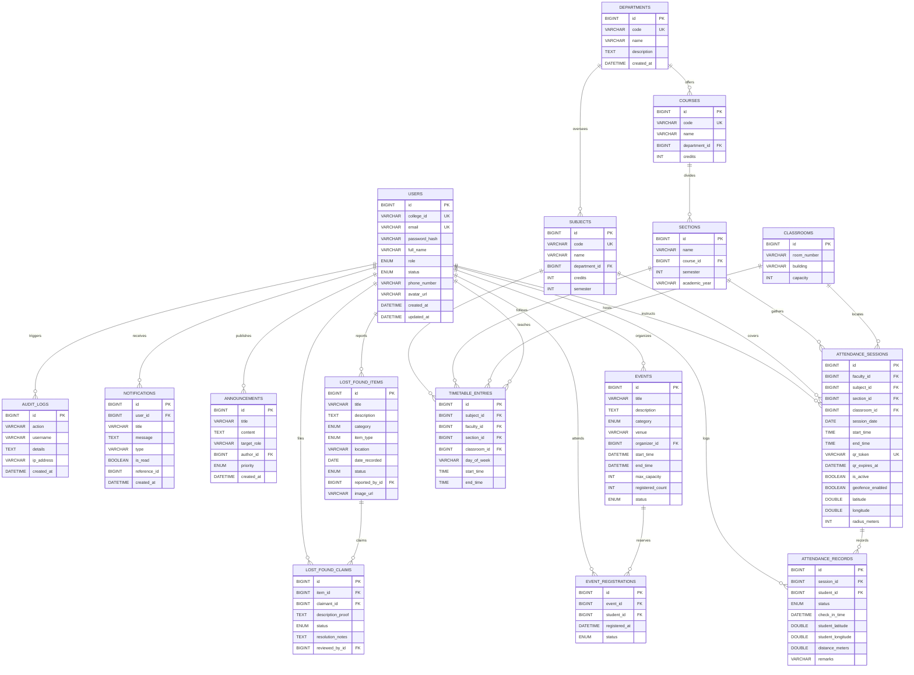

# Smart Campus Super App — Database Schema Specification

## 1. Relational Database Overview
The Smart Campus Super App utilizes a normalized relational database design structured across **21 tables** managed within the dedicated schema:
- **Schema Name**: `smart_campus_db`
- **Engine**: InnoDB
- **Default Character Set**: `utf8mb4`
- **Default Collation**: `utf8mb4_unicode_ci`
- **Migration Engine**: Flyway Database Migrations (`V1__init_schema.sql`, `V2__seed_demo_data.sql`)

---

## 2. Entity-Relationship (ER) Diagram

---

## 3. Relational Table Dictionary

### 3.1 `users`
Primary identity store supporting students, faculty, and administrators.
- `id`: `BIGINT AUTO_INCREMENT PRIMARY KEY`
- `college_id`: `VARCHAR(50) NOT NULL UNIQUE` (e.g. `ADM001`, `FAC101`, `STU1001`)
- `email`: `VARCHAR(150) NOT NULL UNIQUE`
- `password_hash`: `VARCHAR(255) NOT NULL` (BCrypt hash)
- `full_name`: `VARCHAR(150) NOT NULL`
- `role`: `ENUM('STUDENT', 'FACULTY', 'ADMIN') NOT NULL`
- `status`: `ENUM('ACTIVE', 'INACTIVE', 'SUSPENDED') DEFAULT 'ACTIVE'`
- `phone_number`: `VARCHAR(20) NULL`
- `avatar_url`: `VARCHAR(255) NULL`
- `created_at`: `DATETIME DEFAULT CURRENT_TIMESTAMP`
- `updated_at`: `DATETIME DEFAULT CURRENT_TIMESTAMP ON UPDATE CURRENT_TIMESTAMP`

### 3.2 `departments`
Academic faculties and colleges within the university.
- `id`: `BIGINT AUTO_INCREMENT PRIMARY KEY`
- `code`: `VARCHAR(20) NOT NULL UNIQUE` (e.g. `CSE`, `ECE`, `MECH`, `BIOTECH`)
- `name`: `VARCHAR(150) NOT NULL`
- `description`: `TEXT NULL`
- `created_at`: `DATETIME DEFAULT CURRENT_TIMESTAMP`

### 3.3 `courses`
Academic degree tracks and curriculum groupings.
- `id`: `BIGINT AUTO_INCREMENT PRIMARY KEY`
- `code`: `VARCHAR(30) NOT NULL UNIQUE` (e.g. `BTECH_CSE`, `BTECH_ECE`)
- `name`: `VARCHAR(150) NOT NULL`
- `department_id`: `BIGINT NOT NULL REFERENCES departments(id)`
- `credits`: `INT NOT NULL DEFAULT 160`

### 3.4 `sections`
Student cohorts assigned to specific courses and terms.
- `id`: `BIGINT AUTO_INCREMENT PRIMARY KEY`
- `name`: `VARCHAR(20) NOT NULL` (e.g. `A`, `B`, `C`)
- `course_id`: `BIGINT NOT NULL REFERENCES courses(id)`
- `semester`: `INT NOT NULL`
- `academic_year`: `VARCHAR(20) NOT NULL` (e.g. `2025-2026`)
- `UNIQUE KEY uk_section_course (course_id, name, semester, academic_year)`

### 3.5 `classrooms`
Physical campus rooms, lecture theaters, and laboratories.
- `id`: `BIGINT AUTO_INCREMENT PRIMARY KEY`
- `room_number`: `VARCHAR(30) NOT NULL` (e.g. `401`, `Lab-2`)
- `building`: `VARCHAR(100) NOT NULL` (e.g. `Turing Engineering Block`)
- `capacity`: `INT NOT NULL DEFAULT 60`
- `UNIQUE KEY uk_room_building (building, room_number)`

### 3.6 `subjects`
Accredited subjects and laboratory units.
- `id`: `BIGINT AUTO_INCREMENT PRIMARY KEY`
- `code`: `VARCHAR(30) NOT NULL UNIQUE` (e.g. `CS601`)
- `name`: `VARCHAR(150) NOT NULL`
- `department_id`: `BIGINT NOT NULL REFERENCES departments(id)`
- `credits`: `INT NOT NULL DEFAULT 3`
- `semester`: `INT NOT NULL`

### 3.7 `timetable_entries`
Weekly lecture and laboratory allocations.
- `id`: `BIGINT AUTO_INCREMENT PRIMARY KEY`
- `subject_id`: `BIGINT NOT NULL REFERENCES subjects(id)`
- `faculty_id`: `BIGINT NOT NULL REFERENCES users(id)`
- `section_id`: `BIGINT NOT NULL REFERENCES sections(id)`
- `classroom_id`: `BIGINT NOT NULL REFERENCES classrooms(id)`
- `day_of_week`: `VARCHAR(20) NOT NULL` (`MONDAY`..`SATURDAY`)
- `start_time`: `TIME NOT NULL`
- `end_time`: `TIME NOT NULL`
- `INDEX idx_timetable_day (day_of_week)`
- `INDEX idx_timetable_faculty (faculty_id)`
- `INDEX idx_timetable_classroom (classroom_id)`
- `INDEX idx_timetable_section (section_id)`

### 3.8 `attendance_sessions`
Temporary QR attendance check-in sessions.
- `id`: `BIGINT AUTO_INCREMENT PRIMARY KEY`
- `faculty_id`: `BIGINT NOT NULL REFERENCES users(id)`
- `subject_id`: `BIGINT NOT NULL REFERENCES subjects(id)`
- `section_id`: `BIGINT NOT NULL REFERENCES sections(id)`
- `classroom_id`: `BIGINT NULL REFERENCES classrooms(id)`
- `session_date`: `DATE NOT NULL`
- `start_time`: `TIME NOT NULL`
- `end_time`: `TIME NOT NULL`
- `qr_token`: `VARCHAR(100) NOT NULL UNIQUE`
- `qr_expires_at`: `DATETIME NOT NULL`
- `is_active`: `BOOLEAN NOT NULL DEFAULT TRUE`
- `geofence_enabled`: `BOOLEAN NOT NULL DEFAULT FALSE`
- `latitude`: `DOUBLE NULL`
- `longitude`: `DOUBLE NULL`
- `radius_meters`: `INT DEFAULT 100`
- `INDEX idx_session_token (qr_token)`

### 3.9 `attendance_records`
Individual check-in verification logs per student per session.
- `id`: `BIGINT AUTO_INCREMENT PRIMARY KEY`
- `session_id`: `BIGINT NOT NULL REFERENCES attendance_sessions(id)`
- `student_id`: `BIGINT NOT NULL REFERENCES users(id)`
- `status`: `ENUM('PRESENT', 'ABSENT', 'LATE', 'EXCUSED') DEFAULT 'PRESENT'`
- `check_in_time`: `DATETIME DEFAULT CURRENT_TIMESTAMP`
- `student_latitude`: `DOUBLE NULL`
- `student_longitude`: `DOUBLE NULL`
- `distance_meters`: `DOUBLE NULL`
- `remarks`: `VARCHAR(255) NULL`
- `UNIQUE KEY uk_session_student (session_id, student_id)`

### 3.10 `events`
Campus workshops, hackathons, guest lectures, and cultural events.
- `id`: `BIGINT AUTO_INCREMENT PRIMARY KEY`
- `title`: `VARCHAR(200) NOT NULL`
- `description`: `TEXT NOT NULL`
- `category`: `ENUM('ACADEMIC', 'CULTURAL', 'TECHNICAL', 'SPORTS', 'WORKSHOP') NOT NULL`
- `venue`: `VARCHAR(150) NOT NULL`
- `organizer_id`: `BIGINT NOT NULL REFERENCES users(id)`
- `start_time`: `DATETIME NOT NULL`
- `end_time`: `DATETIME NOT NULL`
- `max_capacity`: `INT NOT NULL`
- `registered_count`: `INT NOT NULL DEFAULT 0`
- `status`: `ENUM('UPCOMING', 'ONGOING', 'COMPLETED', 'CANCELLED') DEFAULT 'UPCOMING'`
- `image_url`: `VARCHAR(255) NULL`

### 3.11 `event_registrations`
Real-time student RSVPs for events.
- `id`: `BIGINT AUTO_INCREMENT PRIMARY KEY`
- `event_id`: `BIGINT NOT NULL REFERENCES events(id)`
- `student_id`: `BIGINT NOT NULL REFERENCES users(id)`
- `registered_at`: `DATETIME DEFAULT CURRENT_TIMESTAMP`
- `status`: `ENUM('REGISTERED', 'CANCELLED', 'ATTENDED') DEFAULT 'REGISTERED'`
- `UNIQUE KEY uk_event_student (event_id, student_id)`

### 3.12 `lost_found_items`
Reported campus lost or found belongings.
- `id`: `BIGINT AUTO_INCREMENT PRIMARY KEY`
- `title`: `VARCHAR(150) NOT NULL`
- `description`: `TEXT NOT NULL`
- `category`: `ENUM('ELECTRONICS', 'BOOKS', 'ID_CARDS', 'CLOTHING', 'ACCESSORIES', 'OTHER') NOT NULL`
- `item_type`: `ENUM('LOST', 'FOUND') NOT NULL`
- `location`: `VARCHAR(150) NOT NULL`
- `date_recorded`: `DATE NULL`
- `status`: `ENUM('LOST', 'FOUND', 'CLAIM_PENDING', 'RESOLVED') DEFAULT 'LOST'`
- `reported_by_id`: `BIGINT NOT NULL REFERENCES users(id)`
- `image_url`: `VARCHAR(255) NULL`
- `created_at`: `DATETIME DEFAULT CURRENT_TIMESTAMP`

### 3.13 `lost_found_claims`
Claims submitted by students claiming found property.
- `id`: `BIGINT AUTO_INCREMENT PRIMARY KEY`
- `item_id`: `BIGINT NOT NULL REFERENCES lost_found_items(id)`
- `claimant_id`: `BIGINT NOT NULL REFERENCES users(id)`
- `description_proof`: `TEXT NOT NULL`
- `status`: `ENUM('PENDING', 'APPROVED', 'REJECTED') DEFAULT 'PENDING'`
- `resolution_notes`: `TEXT NULL`
- `reviewed_by_id`: `BIGINT NULL REFERENCES users(id)`
- `created_at`: `DATETIME DEFAULT CURRENT_TIMESTAMP`

### 3.14 `announcements`
Broadcast notices published across the campus.
- `id`: `BIGINT AUTO_INCREMENT PRIMARY KEY`
- `title`: `VARCHAR(200) NOT NULL`
- `content`: `TEXT NOT NULL`
- `target_role`: `VARCHAR(50) DEFAULT 'ALL'`
- `author_id`: `BIGINT NOT NULL REFERENCES users(id)`
- `priority`: `ENUM('NORMAL', 'HIGH', 'URGENT') DEFAULT 'NORMAL'`
- `created_at`: `DATETIME DEFAULT CURRENT_TIMESTAMP`

### 3.15 `notifications`
Targeted user alerts and reminders.
- `id`: `BIGINT AUTO_INCREMENT PRIMARY KEY`
- `user_id`: `BIGINT NOT NULL REFERENCES users(id)`
- `title`: `VARCHAR(150) NOT NULL`
- `message`: `TEXT NOT NULL`
- `type`: `VARCHAR(50) NOT NULL`
- `is_read`: `BOOLEAN NOT NULL DEFAULT FALSE`
- `reference_id`: `BIGINT NULL`
- `created_at`: `DATETIME DEFAULT CURRENT_TIMESTAMP`

### 3.16 `audit_logs`
Security telemetry and operation tracking.
- `id`: `BIGINT AUTO_INCREMENT PRIMARY KEY`
- `action`: `VARCHAR(100) NOT NULL`
- `username`: `VARCHAR(100) NULL`
- `details`: `TEXT NULL`
- `ip_address`: `VARCHAR(50) NULL`
- `created_at`: `DATETIME DEFAULT CURRENT_TIMESTAMP`
